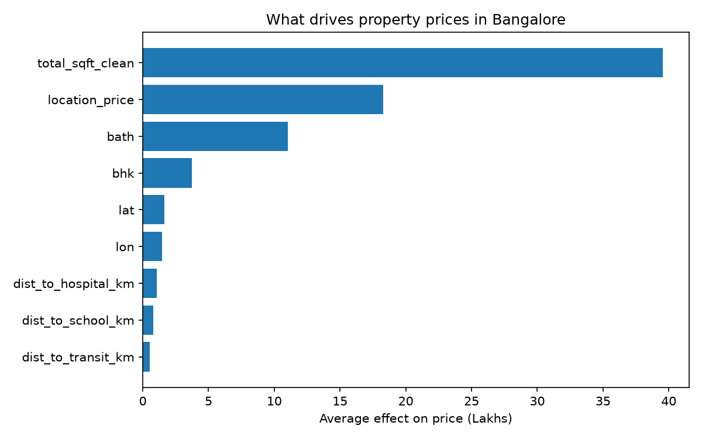
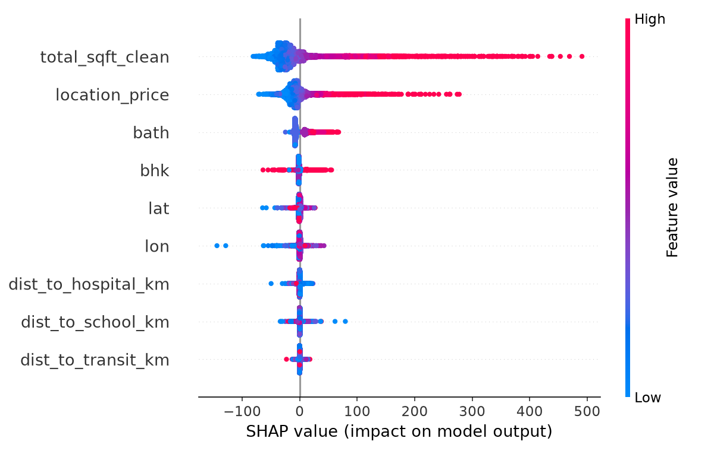

# 🏠 Real Estate AVM: Bangalore

> **Does knowing *where* a home is actually help predict its price, or is it all square footage?**

An **Automated Valuation Model (AVM)** that estimates property prices in Bangalore, explains every estimate, and answers that question with a controlled machine learning experiment.


---

## Contents

1. [Key findings](#-key-findings)
2. [How it works](#-how-it-works)
3. [Quick start](#-quick-start)
4. [Using the app](#-using-the-app)
5. [API](#-api)
6. [The data](#-the-data)
7. [Results in detail](#-results-in-detail)
8. [Project structure](#-project-structure)
9. [Testing](#-testing)
10. [Limitations and future work](#-limitations-and-future-work)
11. [Team](#-team)

---

## 🔑 Key findings

**Research question:** does adding location and amenity data (schools, hospitals, transit) meaningfully improve price prediction over property attributes alone, and by how much?

**Answer: yes, location matters a lot, but at the neighbourhood level.**

| | Property only | + Location | Change |
|---|:---:|:---:|:---:|
| XGBoost RMSE (Lakhs) | 58.95 | **48.28** | **18% lower** |
| XGBoost R² | 0.600 | **0.732** | +0.13 |

- 📉 **Without location, every model loses** to a simple *area rate × size* rule of thumb (baseline RMSE 54.82).
- 📍 **With location, error drops by 18%**, and the tree models clearly beat the baseline.
- 🏘️ **It is the area that matters, not the nearest amenity.** SHAP shows size has the largest effect, then the area's price level. Property features make up **69.5%** of the price effect and location **30.5%**. Distance to the nearest school, hospital or bus stop adds very little on its own.
- 🎯 **Final tuned model:** 23.7% average error, R² 0.752, and **56.7% of estimates within 20%** of the real price on 2,255 unseen listings.

---

## ⚙️ How it works

```
Kaggle listings (13,320)
   │  clean sizes and sqft, geocode area names (Nominatim)
   ▼
Amenity distances (OpenStreetMap Overpass + haversine)
   │  nearest school, hospital, transit stop for each area
   ▼
Final dataset (11,672 rows, 901 areas)
   │  trim outliers, 80/20 split, area price level from training rows only
   ▼
Models: baseline → linear → Random Forest / XGBoost → tuned XGBoost → SHAP
   │
   ▼
FastAPI backend  ◄── JSON ──►  Streamlit app
```

**Features used by the model**

| Group | Features |
|---|---|
| Property | bedrooms (`bhk`), bathrooms (`bath`), size (`total_sqft_clean`) |
| Location | `lat`, `lon`, distance to the nearest school, hospital and transit stop, and `location_price` (the area's median price per sqft, computed from training rows only to avoid data leakage) |

**Built with:** pandas · NumPy · geopy · OpenStreetMap · scikit-learn · XGBoost · SHAP · FastAPI · Pydantic · Streamlit · pydeck · pytest

---

## 🚀 Quick start

**1. Set up**
```bash
git clone https://github.com/manasabomma17-pixel/Real-Estate-AVM.git
cd Real-Estate-AVM
python3 -m venv venv
source venv/bin/activate
pip install -r requirements.txt
```

**2. Start the API** (terminal 1)
```bash
uvicorn backend.main:app --reload
```
Interactive docs: http://127.0.0.1:8000/docs

**3. Start the app** (terminal 2)
```bash
streamlit run frontend/app.py
```
Opens at http://localhost:8501

**4. Check everything** (optional)
```bash
bash run_checks.sh
```
This runs the experiment, the error measurement, SHAP, the tests and a live API check.

> The processed data and the trained model are committed, so the app works straight away. There is no need to re-run the slow geocoding.

---

## 🖥️ Using the app

| Tab | What you get |
|---|---|
| **Predict Price** | Estimate with a likely range, price per sqft, a comparison with similar listings, an asking-price check (fair / overpriced / underpriced), a **"Why this price?"** breakdown, a downloadable summary and a home loan EMI calculator |
| **Similar Properties** | Real listings in the same area with the same BHK, shown as cards with a map, plus optional estimates for each listing |
| **Nearby Neighborhoods** | The 10 closest areas, with price per sqft and how they compare |
| **How It Works** | SHAP importance, the property-vs-location split, and the full experiment results |

**Example:** a 1,200 sqft, 2 BHK flat in Whitefield is estimated at **62.81 Lakhs** (range 47.92 to 77.70). An asking price of 80 Lakhs is flagged as **27.4% overpriced**.

---

## 🔌 API

| Method | Endpoint | Returns |
|---|---|---|
| `GET` | `/health` | Status, model version, number of areas |
| `GET` | `/locations` | The 881 areas the model can price |
| `GET` | `/model-info` | Features and measured error |
| `POST` | `/predict` | Estimate, range, verdict, explanation and warnings |

<details>
<summary><b>Example request and response</b></summary>

```bash
curl -X POST http://127.0.0.1:8000/predict \
  -H "Content-Type: application/json" \
  -d '{"location": "Whitefield", "size_sqft": 1200, "bedrooms": 2, "bathrooms": 2, "asking_price": 80}'
```

```json
{
  "predicted_price": 62.81,
  "price_low": 47.92,
  "price_high": 77.7,
  "error_percent": 23.7,
  "price_per_sqft": 5234.0,
  "verdict": "Looks overpriced",
  "difference_percent": 27.4,
  "base_price": 102.65,
  "factors": [
    {"name": "Size, 1200 sqft", "effect": -26.35},
    {"name": "Bathrooms, 2", "effect": -7.37},
    {"name": "Area price level in Whitefield", "effect": -4.18}
  ],
  "warnings": []
}
```

`factors` are SHAP values: starting from `base_price` (the average property), each one pushes the estimate up or down, and together they add up to `predicted_price`. The response above is shortened to the top three factors.
</details>

**Input checks:** sizes must be positive and at least 200 sqft per bedroom, with 1 to 20 bedrooms. Invalid input returns `422`, and an unknown area returns `404`.

---

## 📊 The data

[**Bengaluru House Price Data**](https://www.kaggle.com/datasets/amitabhajoy/bengaluru-house-price-data) on Kaggle (licence: Apache 2.0). Prices are in **Lakhs** (1 Lakh = ₹1,00,000).

| Step | Rows |
|---|---:|
| Raw listings | 13,320 |
| Valid size and sqft, at least 200 sqft per bedroom | 12,917 |
| Area successfully geocoded (901 areas) | 11,672 |
| Extreme 1% of price per sqft and size removed | **11,272** |
| Train / test split (80/20) | 9,017 / 2,255 |

<details>
<summary><b>Rebuild the data from scratch</b></summary>

1. Download the raw CSV into `data/raw/bangalore/`
2. Run, in order:
```bash
python data_processing/load_bangalore.py              # clean + geocode (~25 min)
python data_processing/compute_amenity_distances.py   # OpenStreetMap queries (~1 hour)
python data_processing/build_final_dataset.py         # merge
```
</details>

---

## 📈 Results in detail

All models use the **same 9,017 training rows** and are scored on the **same 2,255 unseen test rows**. Lower RMSE, MAE and MAPE are better, and higher R² is better.

| Model | Features | RMSE | MAE | MAPE | R² | vs baseline |
|---|---|---:|---:|---:|---:|---:|
| Baseline | Area rate × size | 54.82 | 27.72 | 25.6% | 0.654 | — |
| Random Forest | Property only | 59.17 | 29.73 | 28.4% | 0.597 | −7.9% |
| XGBoost | Property only | 58.95 | 30.06 | 28.7% | 0.600 | −7.5% |
| Random Forest | + position & amenities | 48.07 | 23.77 | 22.7% | 0.734 | +12.3% |
| XGBoost | + position & amenities | 47.52 | 24.14 | 23.3% | 0.740 | +13.3% |
| Random Forest | + area price level (all 9) | 49.41 | 23.61 | 22.0% | 0.719 | +9.9% |
| XGBoost | + area price level (all 9) | 48.28 | 23.88 | 22.7% | 0.732 | +11.9% |
| **Tuned XGBoost** (served) | all 9 | **46.41** | **23.96** | **23.7%** | **0.752** | **+15.3%** |

Linear, Ridge and Lasso regression were also tested (`reports/baseline_and_linear_results.csv`). All of them did worse than the baseline, which confirms that the relationship between location and price is non-linear.

**What drives the price (SHAP)**

<p align="center">
  
  
</p>

| Feature | Average effect (Lakhs) |
|---|---:|
| Size | 39.55 |
| Area price level | 18.28 |
| Bathrooms | 11.01 |
| Bedrooms | 3.71 |
| Latitude / Longitude | 1.64 / 1.48 |
| Distance to hospital / school / transit | 1.06 / 0.79 / 0.54 |

---

## 📁 Project structure

```
Real-Estate-AVM/
├── configs/config.yaml               shared settings: seed, split, features, app rules
├── data/
│   ├── raw/bangalore/                Kaggle CSV (not committed)
│   └── processed/                    cleaned data + location lookup (committed)
├── data_processing/
│   ├── load_bangalore.py             clean + geocode
│   ├── compute_amenity_distances.py  nearest school / hospital / transit
│   ├── build_final_dataset.py        merge into one table
│   ├── clean_location_names.py       duplicate and typo analysis of area names
│   └── prepare_model_data.py         shared preparation for every model
├── backend/
│   ├── main.py                       FastAPI app
│   ├── schemas.py                    request / response validation
│   ├── config.py                     loads config.yaml
│   └── models/
│       ├── train_baseline_and_linear.py
│       ├── train_random_forest_xgboost.py   the main experiment
│       ├── tune_xgboost.py                  tunes + saves the model and lookup
│       ├── measure_error.py
│       ├── explain_model.py                 SHAP
│       └── trained_model.pkl
├── frontend/app.py                   Streamlit app
├── reports/                          results, charts and the viva study guide
├── tests/                            pytest tests
├── run_checks.sh                     one command to verify everything
└── requirements.txt
```

<details>
<summary><b>Re-run the models</b></summary>

```bash
python -m backend.models.train_baseline_and_linear
python -m backend.models.train_random_forest_xgboost
python -m backend.models.tune_xgboost
python -m backend.models.measure_error
python -m backend.models.explain_model
```
</details>

---

## 🧪 Testing

```bash
python -m pytest -q
```

There are **16 tests**, covering:
- **Data preparation:** row counts, no missing values, a repeatable split, and no data leakage in the area price level.
- **API:** valid predictions, price range order, SHAP factors adding up to the estimate, bigger homes costing more, 404 and 422 handling, verdict thresholds, and the size warning.

---

## ⚠️ Limitations and future work

| Limitation | Next step |
|---|---|
| Listing (asking) prices, not sale prices | Use property registration data |
| Location is at area level, not address level | Geocode full addresses where available |
| No sale dates, so no market trends | Get multi-year transaction data |
| 167 of 901 areas are missing amenity data (median-filled) | Re-query with retries, and count amenities nearby instead of only the nearest |
| 21 near-duplicate area names not yet merged | Apply the reviewed name mapping |
| About 24% average error | Add floor, building age, area type and metro distance as features |

**Scope note:** we originally planned to also test the model against market surges (the 2020-2022 boom), but no Indian city publishes dated transaction data in bulk for free (we checked Bangalore, Mumbai and Delhi). We focused on the core question instead.

---

## 👥 Team

| | Role | Owned |
|---|---|---|
| **Sherlyn** | Data & Frontend | Cleaning, geocoding, amenity distances, location name analysis, Streamlit dashboard |
| **Manasa** | Modeling & Backend | Baseline and linear models, Random Forest / XGBoost, tuning, SHAP, FastAPI |

*OJT Project, 2026. Data: Bengaluru House Price Data (Kaggle, Apache 2.0). Amenities and geocoding: © OpenStreetMap contributors.*
